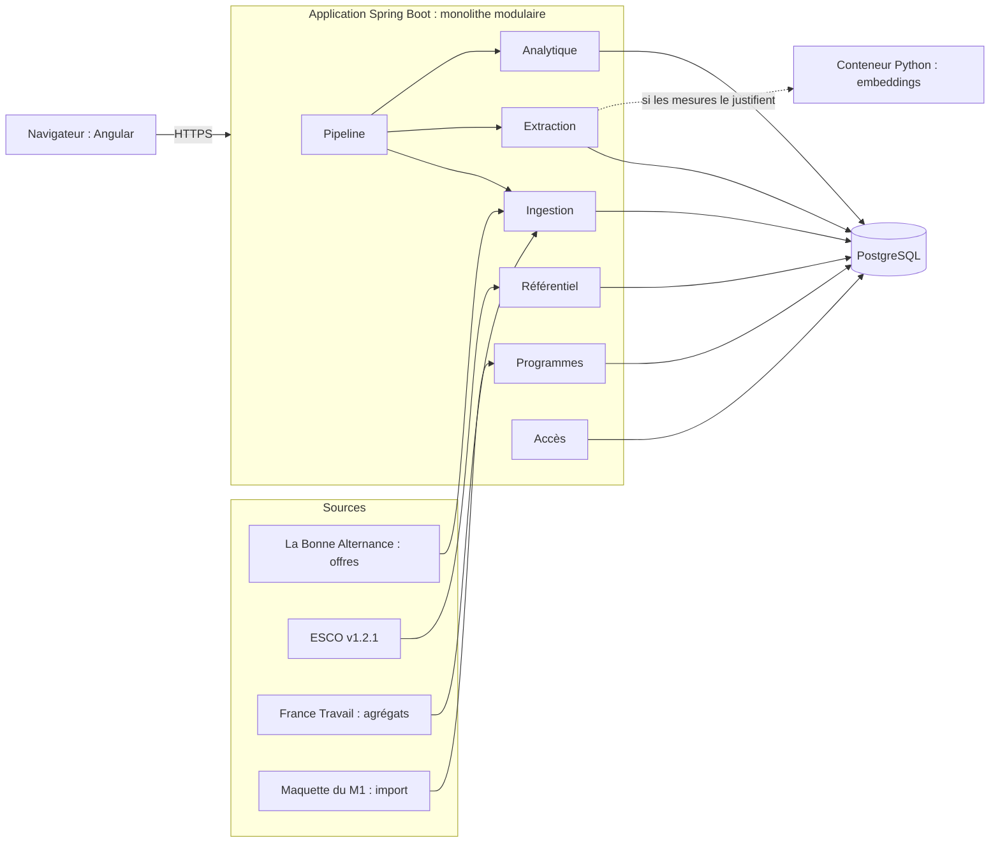

# SkillPath Audit

Mesurer l'écart entre les compétences demandées par le marché de l'emploi et celles enseignées dans une formation, de façon traçable et vérifiable.

**Statut : cadrage terminé, dossier v0.3, squelette du serveur en place** · Master 1 MIAGE, Université Côte d'Azur · 2026-2027

---

## Le problème

Faire évoluer le programme d'une formation repose aujourd'hui sur des impressions et des échanges ponctuels avec des professionnels. Les responsables de formation n'ont pas d'outil simple pour répondre à une question précise : **quelles compétences très demandées ne sont pas enseignées dans notre parcours, et cette demande évolue-t-elle ?**

## Ce que SkillPath Audit vise à faire

- **Normaliser les programmes** : rattacher les modules d'une formation à un référentiel de compétences (ESCO), avec le détail de chaque rattachement.
- **Mesurer la demande** : estimer le poids de chaque compétence sur le marché, par métier, domaine, lieu et période.
- **Calculer un écart explicable** : une formule définie, testée, et qui renvoie aux modules et aux offres qui la justifient.
- **Suivre les tendances** : comparer les périodes sur des agrégats figés et reproductibles.

> Ce que l'outil **ne fait pas** : il ne recommande pas de cours et ne remplace pas la décision pédagogique. Il apporte des éléments de preuve à ceux qui la prennent.

## Statut

| Chantier | État |
|---|---|
| Cadrage du besoin et du périmètre | Rédigé, en attente de validation de l'encadrement |
| Définitions métier (demande, couverture, écart) | Rédigées (chapitre 3 du dossier) |
| Vérification des sources de données | Faite, quelques points à confirmer au premier appel d'API |
| Architecture et décisions (ADR) | 25 décisions au 8 novembre 2026 (ADR 018 et 019 à venir après les mesures d'extraction) |
| Étude des embeddings (demande de l'encadrant) | En cours, mesures sur un jeu annoté à produire |
| Squelette du serveur | Fait : sept modules, vérification des frontières à chaque construction |
| Implémentation du métier | Non démarrée |

Le dépôt contient le squelette du serveur (modules vides et test de frontières), pas encore de fonctionnalité. Les sections ci-dessous distinguent ce qui existe de ce qui est prévu.

## Principes de conception

1. **Chaque indicateur est défini avant d'être calculé.** Pas de score sans formule écrite et testable.
2. **Tout est traçable.** Une compétence signalée renvoie aux offres et aux modules qui la justifient.
3. **Les sources sont remplaçables.** L'accès à une source peut être restreint ou retiré ; le système ne dépend d'aucune en particulier.
4. **Les traitements sont rejouables.** Une étape peut être relancée sans effet de bord.
5. **Les limites sont documentées.** Biais connus, données manquantes et hypothèses sont écrits, pas cachés.

## Architecture cible

Un monolithe modulaire (Spring Boot 3.5 et Spring Modulith 1.4) de sept modules et d'un noyau commun, une base PostgreSQL, une application Angular. Un conteneur Python d'embeddings n'est ajouté que si les mesures le justifient (ADR-010). Voir [docs/architecture/](docs/architecture/vue-densemble.md) et [docs/adr/](docs/adr/README.md).



## Sources de données

Constat au 17 octobre 2026, complété par l'export du 7 novembre 2026. Les points marqués *à vérifier* ne sont pas confirmés par la documentation officielle.

| Source | Contenu | Accès constaté | Réserves |
|---|---|---|---|
| La Bonne Alternance (offres) | Offres d'alternance avec leur texte, compétences déclarées, codes ROME, niveau de diplôme, dates | Clé gratuite, lecture sans habilitation. Recherche : 60 appels par minute. Export mis à jour chaque jour à 3 h : 2 appels par minute | Conditions d'utilisation : usage non lucratif, pas de commercialisation, pas de communication à des tiers, suspension possible sans préavis. À traiter par écrit avant tout déploiement (ADR-011) |
| La Bonne Alternance (certifications) | Blocs de compétences RNCP et codes ROME d'un diplôme | Même clé | Fiche RNCP 39490 (Master MIAGE) identifiée ; contenu de la route à vérifier |
| API Marché du travail (France Travail) | Offres par métier, secteur et compétence, trimestrielles | Ouvert | Authentification et licence à vérifier |
| API Offres d'emploi (France Travail) | Texte des offres | **Restreint**, sur demande | Non exposée publiquement le temps d'une analyse des conditions de réutilisation |
| ESCO v1.2.1 | Référentiel de compétences, 28 langues | Gratuit, réutilisable « pour tout usage » | Mention obligatoire, modifications à signaler |

Une clé de test dirige toutes les requêtes, lectures comprises, vers un environnement de test : les données réelles exigent une clé de production. Un quota dépassé renvoie le code 419 selon la spécification (à confirmer au premier appel). La clé d'API est secrète et ne doit jamais figurer dans le dépôt, pas plus que le texte des offres (conditions d'utilisation de la source).

### Mention ESCO

Ce projet utilise la classification ESCO de la Commission européenne.

## Stack

| Couche | Choix | État |
|---|---|---|
| Interface web | Angular 22, Apache ECharts, client TypeScript généré depuis le contrat OpenAPI | Décidé (ADR-004), remplace le choix initial de React |
| API | Java 25, Spring Boot 3.5.16, Spring Modulith 1.4.13, REST avec contrat OpenAPI généré du code | Décidé (ADR-003, ADR-012, ADR-020) |
| Collecte | Spring Batch, déclenchée après 3 h (Europe/Paris) | Décidé (ADR-009) |
| Base de données | PostgreSQL, migrations Flyway | Décidé (ADR-008) |
| Extraction des compétences | Méthode des termes en Java derrière une interface ; embeddings à mesurer | Décidé (ADR-010, ADR-021) |
| Identité et accès | Comptes locaux, Spring Security, session par cookie | Décidé (ADR-013) |
| Exécution | Docker Compose sur un serveur virtuel | Décidé (ADR-014) |
| Intégration continue | GitHub Actions | Décidé (ADR-017) |

Une décision reste provisoire, pour le mode local : la conservation des données brutes (ADR-011), à rouvrir avant tout déploiement. L'hébergeur n'est pas choisi (ADR-014). Spring Boot 3.5 n'a plus de support libre depuis le 30 juin 2026 : migration vers Spring Boot 4.1 ou 4.2 avant tout déploiement (ADR-020).

## Structure du dépôt

Les dossiers `docs/` et `backend/` existent ; `frontend/` et `deploy/` seront créés quand leur contenu arrivera.

```
SkillPath_/
├── README.md
├── docs/            dossier de cadrage, ADR, architecture, étude des embeddings
├── backend/         application Spring Boot (sept modules et noyau commun), migrations Flyway à venir
├── frontend/        application Angular
├── deploy/          Docker Compose
└── .github/         modèles d'issues et de pull requests, CI
```

## Documentation

- **Dossier de cadrage** : version 0.3, hors dépôt pour l'instant ; ses décisions sont extraites dans `docs/adr/`.
- **Décisions d'architecture (ADR)** : [docs/adr/](docs/adr/README.md), un fichier par décision, avec les alternatives écartées.
- **Architecture** : [docs/architecture/vue-densemble.md](docs/architecture/vue-densemble.md), schémas Mermaid.
- **Équipe** : [guide d'intégration](docs/GUIDE-EQUIPE.md), [répartition du travail](docs/repartition.md), [catalogue des lots](docs/catalogue-des-lots.md).
- **Contribuer** : [CONTRIBUTING.md](CONTRIBUTING.md).

## Démarrer

Vérifier le serveur sans rien installer d'autre que Docker (depuis le dossier `backend`) :

```
docker run --rm -v "${PWD}:/work" -w /work maven:3.9-eclipse-temurin-25 mvn -B verify
```

Le test `ModularityTests` affiche les modules détectés et échoue si une frontière entre modules est franchie. Voir [backend/README.md](backend/README.md).

## Fonctionnement de l'équipe

- La branche `main` est modifiée par pull request, relue par un autre membre avant fusion.
- Chaque tâche correspond à une issue, suivie dans le GitHub Project « SkillPath Audit ».
- Les titres de commit et de pull request sont en anglais (Conventional Commits), les descriptions en français.
- Une décision structurante donne lieu à un ADR. Les structures proposées sont un point de départ : chacun peut les faire évoluer.

## Équipe

| Nom |
|---|
| Abdellah JEBAR |
| Abdelouarite GHILAN EL HASSANI |
| Maimouna BAH |
| Bouchra MEZRHAB |
| Elhadj Oumar DIALLO |

Encadrement : M. Donati, Master 1 MIAGE, Université Côte d'Azur.

## Licence

À définir. Le dépôt est privé et le projet est réalisé dans un cadre universitaire.
