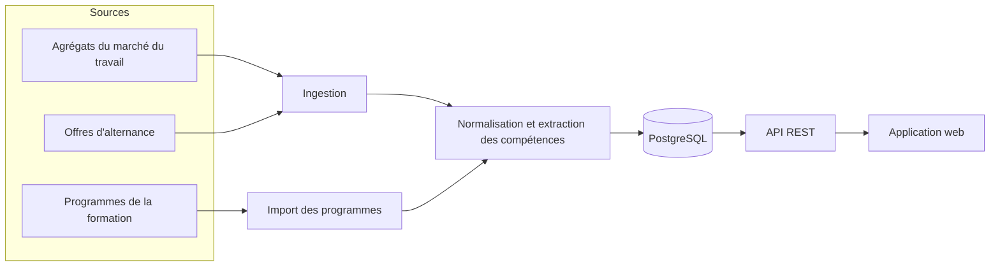

# SkillPath Audit

Mesurer l'écart entre les compétences demandées par le marché de l'emploi et celles enseignées dans une formation, de façon traçable et vérifiable.

**Statut : cadrage** · Master 1 MIAGE, Université Côte d'Azur · 2026-2027

---

## Le problème

Faire évoluer le programme d'une formation repose aujourd'hui sur des impressions et des échanges ponctuels avec des professionnels. Les responsables de formation n'ont pas d'outil simple pour répondre à une question précise : **quelles compétences très demandées ne sont pas enseignées dans notre parcours, et cette demande évolue-t-elle ?**

## Ce que SkillPath Audit vise à faire

- **Normaliser les programmes** : rattacher les modules d'une formation à un référentiel de compétences (ESCO), avec le détail de chaque rattachement.
- **Mesurer la demande** : estimer le poids de chaque compétence sur le marché, par métier, domaine, lieu et période.
- **Calculer un écart explicable** : une formule définie, testée, et qui renvoie aux modules et aux offres qui la justifient.
- **Suivre les tendances** : comparer les périodes sur des agrégats figés et reproductibles.

> Ce que l'outil **ne fait pas** : il ne recommande pas de cours et ne remplace pas la décision pédagogique. Il apporte des éléments de preuve à ceux qui la prennent.

## Statut

| Chantier | État |
|---|---|
| Cadrage du besoin et du périmètre | En cours |
| Définitions métier (demande, couverture, écart) | À rédiger |
| Vérification des sources de données | En cours |
| Architecture et décisions (ADR) | À rédiger |
| Implémentation | Non démarrée |

Ce dépôt ne contient pas encore de code. Les sections ci-dessous décrivent l'**intention** et les choix connus, sans présenter comme réalisé ce qui ne l'est pas.

## Principes de conception

1. **Chaque indicateur est défini avant d'être calculé.** Pas de score sans formule écrite et testable.
2. **Tout est traçable.** Une compétence signalée renvoie aux offres et aux modules qui la justifient.
3. **Les sources sont remplaçables.** L'accès à une source peut être restreint ou retiré ; le système ne dépend d'aucune en particulier.
4. **Les traitements sont rejouables.** Une étape peut être relancée sans effet de bord.
5. **Les limites sont documentées.** Biais connus, données manquantes et hypothèses sont écrits, pas cachés.

## Architecture cible

Sujette aux décisions d'architecture (ADR) à venir.



## Sources de données

Constat au 14 octobre 2026. Les points marqués *à vérifier* ne sont pas confirmés par la documentation officielle.

| Source | Contenu | Accès constaté | Réserves |
|---|---|---|---|
| API Marché du travail (France Travail) | Offres par métier, secteur et compétence, trimestrielles | Ouvert | Authentification et licence à vérifier |
| API Offres d'emploi (France Travail) | Texte des offres | **Restreint**, sur demande | Non exposée publiquement le temps d'une analyse des conditions de réutilisation |
| La Bonne Alternance | Offres d'alternance | API publique, compte requis | Champs, quotas et conditions à vérifier |
| ESCO v1.2.1 | Référentiel de compétences, 28 langues | Téléchargement gratuit | Licence de réutilisation à vérifier |

## Stack

| Couche | Choix | État |
|---|---|---|
| Interface web | React, shadcn/ui, Tailwind | Retenu |
| API | Java, Spring Boot, monolithe modulaire | Proposé, ADR à venir |
| Base de données | PostgreSQL | Proposé, ADR à venir |
| Extraction par traitement du langage | Python, service isolé | Proposé, ADR à venir |

## Structure du dépôt

Structure cible, créée au fil de l'implémentation.

```
SkillPath_/
├── README.md
├── docs/            dossier de cadrage, ADR, définitions métier
├── backend/         API et logique métier
├── frontend/        application web
├── extraction/      service d'extraction des compétences
├── database/        schéma et migrations
└── .github/         modèles d'issues et de pull requests, CI
```

## Documentation

- **Dossier de cadrage** : en cours de rédaction, versionné dans `docs/`.
- **Décisions d'architecture (ADR)** : une décision par fichier, avec les alternatives écartées.

## Démarrer

Aucun composant n'est exécutable pour l'instant. Cette section sera complétée avec l'objectif d'un démarrage en une commande dès le premier livrable.

## Fonctionnement de l'équipe

- La branche `main` est protégée : toute modification passe par une pull request et au moins une relecture.
- Chaque tâche correspond à une issue, suivie dans un GitHub Project.
- Les messages de commit suivent la convention Conventional Commits.
- Une décision structurante donne lieu à un ADR.

## Équipe

| Nom | Rôle |
|---|---|
| Abdellah JEBAR | À définir |
| Yao Junior Guy-Ange KRA | À définir |
| Abdelouarite GHILAN EL HASSANI | À définir |
| Maimouna BAH | À définir |
| Bouchra MEZRHAB | À définir |

Encadrement : M. Donati, Master 1 MIAGE, Université Côte d'Azur.

## Licence

À définir. Le dépôt est privé et le projet est réalisé dans un cadre universitaire.
