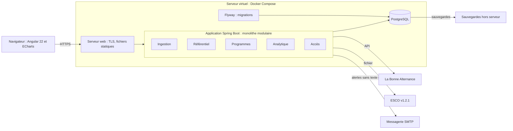
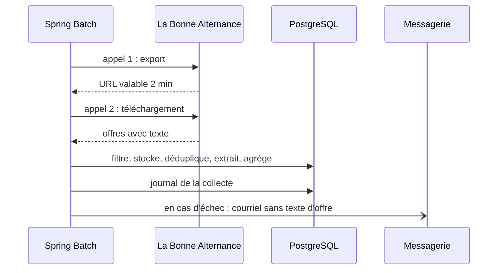
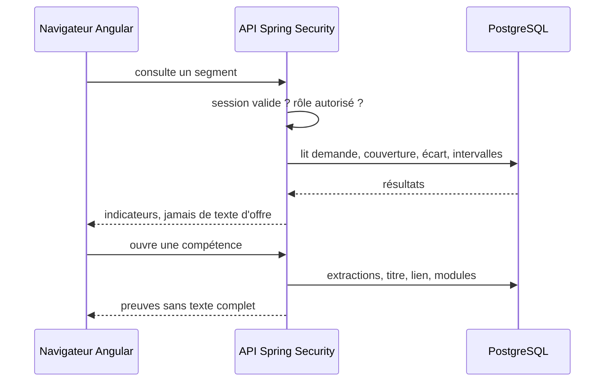
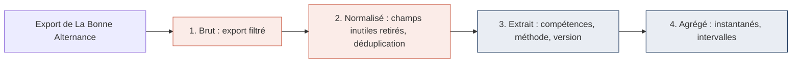

# Vue d'ensemble de l'architecture

Schémas tirés du chapitre 5 du dossier de cadrage, version 0.2. Les décisions sont au statut proposé : voir [docs/adr/](../adr/README.md).

## Conteneurs et modules

Un monolithe modulaire de cinq modules, une base PostgreSQL, un serveur virtuel exécutant Docker Compose. Deux frontières de confiance : celle des utilisateurs, et celle des sources externes. Voir [ADR-003](../adr/adr-003.md) et [ADR-014](../adr/adr-014.md).

## Collecte de nuit

Un job Spring Batch par collecte, déclenché après 3 h (Europe/Paris). L'export est limité à deux appels par minute, et son adresse est valable deux minutes. Voir [ADR-009](../adr/adr-009.md).

Chemins d'échec : quota dépassé (code 419 selon la spécification, à confirmer au premier appel) puis attente et nouvelle tentative ; adresse expirée puis deux nouveaux appels ; étape en erreur puis reprise avec les mêmes paramètres, sans doublon ; aucune collecte réussie depuis 26 heures : alerte.

## Consultation d'un indicateur

Le texte d'une offre n'est jamais renvoyé : seules les preuves (compétences extraites, titre, lien de candidature, modules) le sont. Voir [ADR-005](../adr/adr-005.md), [ADR-012](../adr/adr-012.md) et [ADR-013](../adr/adr-013.md).

Codes d'erreur : 401 si non connecté, 403 si le rôle n'est pas autorisé, 503 si la base est indisponible.

## Cycle de vie des données

À partir de l'état « extrait », plus aucun texte d'offre : seulement des données dérivées. Voir [ADR-008](../adr/adr-008.md) et [ADR-011](../adr/adr-011.md).

